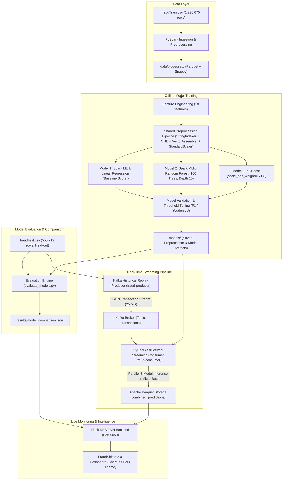

# FraudShield 2.0: Real-Time Big Data Financial Fraud Detection System

[](https://spark.apache.org/)
[](https://kafka.apache.org/)
[](https://www.python.org/)
[](https://flask.palletsprojects.com/)
[](https://www.docker.com/)
[](https://xgboost.readthedocs.io/)

FraudShield 2.0 is an enterprise-grade, end-to-end Big Data machine learning pipeline designed to detect fraudulent credit card transactions in real time. Built upon **Apache Kafka**, **Apache Spark 3.5.0 Structured Streaming**, and **Apache Parquet**, FraudShield 2.0 runs real-time parallel inference across three distinct machine learning models (**Linear Regression Baseline Scorer**, **PySpark Random Forest Classifier**, and **XGBoost Classifier**) against a continuous historical transaction replay stream.

> **Dataset Disclaimer**: The underlying dataset originates from [Kaggle Kartik2112 Fraud Detection](https://www.kaggle.com/datasets/kartik2112/fraud-detection), generated via the **Sparkov Data Generation tool**. It realistically simulates human purchasing habits, merchant locations, and fraud attack patterns across 1.85 million transactions. It is **simulated transaction data**, not actual bank-collected customer records.

---

## 1. System Architecture



---

## 2. Six-Service Docker Architecture

The streaming pipeline is orchestrated using Docker and Docker Compose with 6 dedicated services:

| Service | Container Name | Technology | Ports | Role |
|---|---|---|---|---|
| **Zookeeper** | `zookeeper` | Confluent CP-Zookeeper 7.5.0 | `2181:2181` | Cluster state coordination & Kafka metadata leader election. |
| **Kafka Broker** | `kafka` | Confluent CP-Kafka 7.5.0 | `9092:9092` | High-throughput distributed event log (`transactions` topic). |
| **Spark Master** | `spark-master` | Apache Spark 3.5.0 | `7077:7077`, `8080:8080` | Cluster resource manager and master web interface. |
| **Spark Worker** | `spark-worker` | Apache Spark 3.5.0 | `8081:8081` | Distributed execution worker (2 CPU cores, 2GB RAM). |
| **Fraud Producer** | `fraud-producer` | Python 3.11, `kafka-python` | Internal network | Streams held-out test transactions from `fraudTest.csv` at configurable TPS (default: 25 tx/s). |
| **Fraud Consumer** | `fraud-consumer` | Spark 3.5.0, PySpark, XGBoost | `4040:4040` | Spark Structured Streaming consumer scoring transactions across all 3 models in parallel. |

---

## 3. Data Preprocessing & Feature Engineering

The feature engineering module (`features/feature_engineering.py`) derives 18 predictive features using pure Spark SQL catalyst expressions to avoid Python worker overhead:

| Feature Category | Feature Column | Computation / Transformation | Purpose |
|---|---|---|---|
| **Temporal** | `transaction_hour` | $\text{hour}(\text{timestamp})$ [0–23] | Captures diurnal transaction patterns. |
| **Temporal** | `transaction_day` | $\text{dayofmonth}(\text{timestamp})$ [1–31] | Captures monthly pay-cycle behaviors. |
| **Temporal** | `transaction_month` | $\text{month}(\text{timestamp})$ [1–12] | Captures seasonal fraud fluctuations. |
| **Temporal** | `transaction_day_of_week` | $\text{dayofweek}(\text{timestamp})$ [1=Sun, 7=Sat] | Captures weekend fraud surges. |
| **Temporal** | `is_night_transaction` | $\mathbb{I}(\text{hour} \ge 22 \lor \text{hour} \le 5)$ | Flags high-risk late-night / early-morning purchases. |
| **Temporal** | `is_weekend` | $\mathbb{I}(\text{dayofweek} \in \{1, 7\})$ | Flags non-business day activity. |
| **Transaction** | `transaction_amount` | $\text{amt}$ (float) | Raw purchase amount in USD. |
| **Transaction** | `log_transaction_amount` | $\ln(1 + \text{amt})$ | Dampens extreme transaction skew and power-law distribution. |
| **Geographic** | `cardholder_latitude` | $\text{lat}$ | Cardholder home latitude coordinate. |
| **Geographic** | `cardholder_longitude` | $\text{long}$ | Cardholder home longitude coordinate. |
| **Geographic** | `merchant_latitude` | $\text{merch\_lat}$ | Merchant terminal latitude. |
| **Geographic** | `merchant_longitude` | $\text{merch\_long}$ | Merchant terminal longitude. |
| **Spatial Distance** | `home_to_merchant_distance` | Haversine Formula ($R=6371\text{km}$) | Physical distance between cardholder residence and transaction point. |
| **Customer** | `customer_age` | $(\text{trans\_date} - \text{dob}) / 365.25$ | Cardholder age at transaction timestamp. |
| **Demographics** | `log_city_pop` | $\ln(1 + \text{city\_pop})$ | City urbanization scale. |
| **Categorical** | `category_ohe` | One-Hot Encoded (14 merchant categories) | Purchase domain (grocery, travel, shopping, entertainment, etc.). |
| **Categorical** | `gender_ohe` | One-Hot Encoded (`M`, `F`) | Cardholder gender. |
| **Categorical** | `state_ohe` | One-Hot Encoded (50 US states) | Transaction jurisdiction. |

> **Strict Anti-Leakage Guardrail**: Direct personal identifiers (`cc_num`, `trans_num`, cardholder names, street addresses) are excluded from model training. The ground-truth label `actual_is_fraud` is included in Kafka solely for downstream accuracy verification and is **never** fed to the ML estimators.

---

## 4. Machine Learning Models & Evaluated Results

All three models were trained on `fraudTrain.csv` (1,296,675 records, 7,506 frauds) and evaluated on the held-out `fraudTest.csv` (555,719 records, 2,145 frauds, natural 0.39% fraud distribution).

### Evaluation Metrics Comparison Table

| Metric | Linear Regression (Baseline) | Random Forest | XGBoost (Recommended) |
|---|:---:|:---:|:---:|
| **ROC-AUC** | 0.8940 | 0.9861 | **0.9960** |
| **PR-AUC (Precision-Recall AUC)** | 0.1618 | 0.7086 | **0.8461** |
| **Precision** | 35.33% | 13.77% | **43.68%** |
| **Recall (Fraud Detection Rate)** | 34.97% | **92.17%** | 88.44% |
| **F1 Score** | 0.3515 | 0.2395 | **0.5848** |
| **Overall Accuracy** | 99.50% | 97.74% | **99.52%** |
| **False Positive Rate (FPR)** | **0.25%** | 2.24% | 0.44% |
| **False Negative Rate (FNR)** | 65.03% | **7.83%** | 11.56% |
| **True Positives (TP)** | 750 / 2,145 | **1,977 / 2,145** | 1,897 / 2,145 |
| **False Positives (FP)** | 1,373 | 12,385 | **2,446** |
| **True Negatives (TN)** | 552,201 | 541,189 | 551,128 |
| **False Negatives (FN)** | 1,395 | **168** | 248 |
| **Training Time** | **25.1s** | 488.1s | 794.0s |
| **Inference Time (555K rows)** | 26.86s | 50.45s | **20.48s** |
| **Calibrated Threshold** | 0.10 | 0.50 | 0.60 |

*All metrics are verified empirical results loaded directly by the dashboard from [results/model_comparison.json](fraud-detection-pipeline-main/results/model_comparison.json).*

### Detailed Model Profiles:

1. **Model 1: Linear Regression (Baseline Fraud Scorer)**
   - Implemented via `pyspark.ml.regression.LinearRegression` with L2 regularization (`regParam=0.001`).
   - Generates continuous risk scores against the binary target. Scores are converted to binary predictions via a calibrated threshold ($t=0.10$) derived by maximizing validation F1.
   - Serves as an analytical baseline demonstrating why linear regression underperforms non-linear models on extreme class imbalance.

2. **Model 2: PySpark Random Forest Classifier**
   - Implemented via `pyspark.ml.classification.RandomForestClassifier` with 100 decision trees, max depth of 10, and class weight balancing.
   - Achieves the highest recall (**92.17%** fraud detection rate), capturing 1,977 of 2,145 frauds, but suffers from higher false alarms (12,385 false positives, 13.77% precision).

3. **Model 3: XGBoost Classifier (Champion Model)**
   - Implemented via distributed XGBoost with `scale_pos_weight = 171.8` to account for the 171:1 class imbalance ratio, 300 estimators, and validation PR-AUC optimization.
   - Delivers the best overall operational performance: **PR-AUC 0.8461**, **ROC-AUC 0.9960**, **F1 0.5848**, and **43.68% precision** while retaining an **88.44% recall** (only 2,446 false alarms across 555,719 transactions).

---

## 5. Real-Time Streaming & Storage Mechanics

### Kafka Replay Producer (`producer/transaction_producer.py`)
- Reads held-out test transactions sequentially from `fraudTest.csv`.
- Dispatches JSON messages to topic `transactions` at a steady configurable rate (default: 25 transactions per second).
- Attaches `actual_is_fraud` as a separate metadata field for downstream audit logging without passing it into feature extraction.
- Supports start, pause, resume, and full replay cycling.

### Structured Streaming Consumer (`consumer/spark_consumer_ml.py`)
- Reads raw streaming messages from Kafka in micro-batches (5-second trigger intervals).
- Applies feature engineering and runs parallel inference across all three models.
- Generates transaction-level records:
  ```json
  {
    "transaction_id": "c804bbd41661c823c43bee55be7bc341",
    "trans_date_trans_time": "2020-06-22 09:25:03",
    "amt": 15.24,
    "merchant": "fraud_Jones, Sawayn and Romaguera",
    "category": "misc_net",
    "actual_is_fraud": 0,
    "lr_score": 0.0020,
    "lr_prediction": 0,
    "lr_correct": 1,
    "rf_score": 0.1085,
    "rf_prediction": 0,
    "rf_correct": 1,
    "xgb_score": 0.0011,
    "xgb_prediction": 0,
    "xgb_correct": 1,
    "prediction_timestamp": "2026-11-05 06:40:00"
  }
  ```
- Appends predictions to Apache Parquet format using Snappy compression under `storage/predictions/combined_predictions/`.

---

## 6. FraudShield Dashboard

The dashboard provides real-time visibility into transactions, multi-model consensus, and container health:

- **Web URL**: `http://localhost:5050`
- **Dark Financial Analytics Theme**: Built with HTML5, CSS3, JavaScript, and Chart.js.
- **Key Modules**:
  1. **Executive KPI Ribbon**: Total transactions processed, actual fraud detected, legitimate traffic count, and live fraud rate.
  2. **6-Container Infrastructure Health**: Real-time status indicators for all Docker services with automatic restart indicators.
  3. **3-Model Comparison Matrix**: Tabular side-by-side view with best-in-class metric badges and individual confusion matrices.
  4. **Live Transaction Feed**: Real-time incoming transactions highlighting consensus fraud (Red), consensus legit (Green), and model disagreements (Yellow).
  5. **Model Consensus Donut**: Visualizing agreement (Unanimous Fraud, Unanimous Legit, 2-Model Flagged, 1-Model Flagged).
  6. **Dynamic Model Leaderboard**: Real-time sortable ranking of models based on Recall, Precision, F1, PR-AUC, or inference latency.
  7. **Interactive Pipeline Controls**: One-click **Start Pipeline**, **Stop Pipeline**, **Pause**, **Resume**, and **Replay Dataset** buttons.

### REST API Endpoints:

| Endpoint | Method | Description |
|---|:---:|---|
| `/api/health` | `GET` | Service health status and API version. |
| `/api/containers` | `GET` | Real-time status of all 6 Docker containers. |
| `/api/models/comparison` | `GET` | Measured evaluation metrics for Linear Regression, Random Forest, and XGBoost. |
| `/api/models/linear-regression` | `GET` | Individual metrics and confusion matrix for Linear Regression. |
| `/api/models/random-forest` | `GET` | Individual metrics and confusion matrix for Random Forest. |
| `/api/models/xgboost` | `GET` | Individual metrics and confusion matrix for XGBoost. |
| `/api/model-agreement` | `GET` | Consensus statistics across all 3 models from streaming Parquet data. |
| `/api/predictions/live` | `GET` | Latest 100 transactions scored by all 3 models with ground-truth comparison. |
| `/api/fraud-caught` | `GET` | Transactions where at least one model flagged fraud. |
| `/api/transactions` | `GET` | In-memory transaction telemetry and live log feed. |
| `/api/pipeline/start` | `POST` | Launch Docker Compose streaming services (`docker compose up -d`). |
| `/api/pipeline/stop` | `POST` | Stop Docker Compose streaming services (`docker compose down`). |
| `/api/pipeline/pause` | `POST` | Pause transaction stream (`docker pause fraud-producer`). |
| `/api/pipeline/resume` | `POST` | Resume transaction stream (`docker unpause fraud-producer`). |
| `/api/pipeline/replay` | `POST` | Restart producer from transaction 0 (`docker restart fraud-producer`). |

---

## 7. Quickstart Guide

### Prerequisites
- **Docker Desktop** (with Docker Compose v2)
- **Python 3.11 or 3.12**
- **Dashboard Python packages**: Flask, Flask-CORS, pandas, and PyArrow (`dashboard/requirements.txt`)
- **Apache Spark 3.5.0** (or let Docker handle Spark container execution)
- **Hadoop Winutils** (only if training natively on Windows: `C:\hadoop\bin\winutils.exe`)

### Step 1: Clone Repository & Place Data Files
```bash
git clone https://github.com/jayesh1310/FraudShield-2.0.git
cd FraudShield-2.0
```
Download `fraudTrain.csv` and `fraudTest.csv` from [Kaggle Kartik2112 Fraud Detection](https://www.kaggle.com/datasets/kartik2112/fraud-detection) and place them in the project root:
```text
Fraud-Detection/
  fraudTrain.csv
  fraudTest.csv
  fraud-detection-pipeline-main/
  dashboard/
```

### Step 2: Check the model files

The streaming consumer needs the fitted preprocessor and all three trained models under `fraud-detection-pipeline-main/models/`. Spark model Parquet files are included in the repository, and the comparison metrics are in `results/model_comparison.json`.

To train and evaluate the models using `fraudTrain.csv` and `fraudTest.csv`:
```powershell
cd fraud-detection-pipeline-main
python training/train_models.py
python training/evaluate_models.py
cd ..
```
Native training requires the training dependencies and a working local Spark/Java setup. The model training and evaluation steps can take substantial time.

### Step 3: Install dashboard dependencies

From the project root, install the dashboard requirements into the Python environment you intend to use:

```powershell
python -m pip install -r dashboard/requirements.txt
```

### Step 4: Start on Windows

From the project root, run:

```powershell
.\start_project.bat
```

The script checks `fraudTest.csv` and the dashboard dependencies, starts Docker Desktop if needed, starts the six Compose services and the Flask dashboard, opens the browser, and follows the consumer logs. The first Docker startup can take longer while images are built or downloaded. Press **Ctrl+C** to stop following the logs; the services keep running.

**Starting from scratch:** the launcher deletes the `consumer_v2` streaming checkpoint, so the consumer does not resume its previous checkpoint. It also forcibly stops processes using port 5050. Existing prediction files are not deleted by the launcher. Use the manual commands below if you need to preserve the checkpoint or a process on that port.

To stop the project, run this in another PowerShell window from the project root:

```powershell
.\stop_project.bat
```

The stop script brings down Compose services and attempts to terminate processes using the project's listed ports, including 5050, 9092, 4040, 8080, 8081, and 7077. Check for unrelated applications using those ports before running it.

### Manual startup

To start without resetting the streaming checkpoint, from `fraud-detection-pipeline-main/`:
```powershell
docker compose up -d --build
```
Verify all 6 services are running:
```powershell
docker compose ps
```

In a separate terminal, from `dashboard/`:
```powershell
python app.py
```

### Open Dashboard & Monitor
Open **[http://localhost:5050](http://localhost:5050)** in your browser.

- **Spark Master UI**: [http://localhost:8080](http://localhost:8080)
- **Spark Worker UI**: [http://localhost:8081](http://localhost:8081)
- **Spark Streaming Jobs UI**: [http://localhost:4040](http://localhost:4040)

To stop the Compose services from `fraud-detection-pipeline-main/`:
```powershell
docker compose down
```
Stop the separately launched dashboard with **Ctrl+C** in its terminal. The dashboard's **Stop Pipeline** button stops the Compose pipeline.

---

## 8. Repository Structure

```text
Fraud-Detection/
├── .gitignore                                      # Excludes large CSVs, Parquet storage, checkpoints, .crc files
├── README.md                                       # Comprehensive system documentation & evaluation report
├── start_project.bat                               # Windows launcher for Docker services and dashboard
├── stop_project.bat                                # Windows stop script
├── dashboard/
│   ├── app.py                                      # Flask REST API backend, log poller & pipeline controller
│   ├── index.html                                  # Modern dark financial analytics UI (Chart.js)
│   └── requirements.txt                            # Dashboard Python dependencies
└── fraud-detection-pipeline-main/
    ├── docker-compose.yml                          # 6-service Docker orchestration
    ├── consumer/
    │   ├── Dockerfile                              # Spark 3.5.0 + Python dependencies + Kafka JARs
    │   ├── requirements.txt                        # pyspark, kafka-python, xgboost, scikit-learn, pandas
    │   └── spark_consumer_ml.py                    # 3-model parallel streaming inference & Parquet sink
    ├── features/
    │   └── feature_engineering.py                  # Pure Spark SQL feature engineering (18 features)
    ├── ingestion/
    │   └── ingest_data.py                          # CSV to optimized Parquet ingestion utility
    ├── models/
    │   ├── model_metadata.json                     # Feature dimensions, calibrated thresholds, scale_pos_weight
    │   ├── preprocessor/                           # Fitted StringIndexer, OHE, VectorAssembler, StandardScaler
    │   ├── linear_regression/                      # Trained Spark MLlib LinearRegression model
    │   ├── random_forest/                          # Trained Spark MLlib RandomForest model (100 trees)
    │   └── xgboost/                                # Saved XGBoost Booster (xgb_model.json)
    ├── producer/
    │   ├── Dockerfile                              # Lightweight Python 3.11 streaming container
    │   ├── requirements.txt                        # kafka-python
    │   └── transaction_producer.py                 # Historical transaction replay Kafka producer
    ├── results/
    │   └── model_comparison.json                   # Verified empirical evaluation metrics for all 3 models
    ├── storage/                                    # Parquet prediction sink & micro-batch checkpoints
    └── training/
        ├── train_models.py                         # 3-model training & threshold calibration script
        └── evaluate_models.py                      # Multi-metric evaluation on held-out fraudTest.csv
```

---

## 9. License & Attribution
- Dataset: [Kartik2112 Fraud Detection Dataset](https://www.kaggle.com/datasets/kartik2112/fraud-detection) generated using the open-source Sparkov Data Generation tool.
- Developed as a Big Data financial fraud detection architecture.
